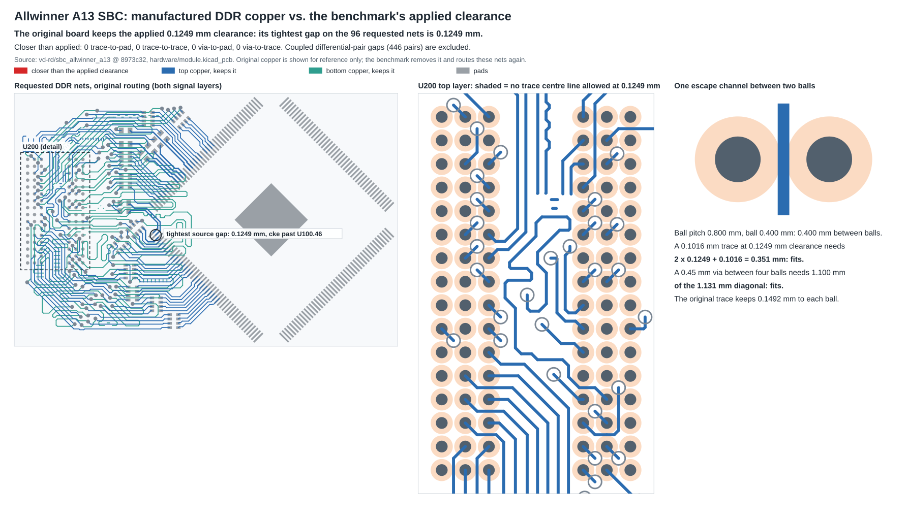

# A13 is benchmarked under a clearance its own board keeps

Every circuit removes the original routing and asks Core to route the same DDR
nets under `rules.appliedGlobalClearance`. A13 used 0.2 mm, the largest
clearance declared by the source net classes.

The manufactured board,
[vd-rd/sbc_allwinner_a13 @ 8973c32](https://github.com/vd-rd/sbc_allwinner_a13/blob/8973c32c64349515da64e268cc03ea8c0789ca2a/hardware/module.kicad_pcb),
does not keep 0.2 mm on these nets: 308 copper pairs are closer. At 0.2 mm the
RAM cannot be escaped at all. `U200` has 0.4 mm balls on a 0.8 mm pitch; one
0.1016 mm trace would need 0.502 mm of the 0.400 mm between balls, and a 0.45 mm
via would need 1.250 mm of the 1.131 mm diagonal.

The board does not keep its other declared clearance, 0.127 mm, everywhere
either: the `cke` trace leaves the CPU past pad `U100.46` at 0.1249 mm (circled
in the overview). Every other pair keeps at least 0.1271 mm.

A13 is now capped at 0.1249 mm, the tightest clearance its manufactured DDR
copper keeps, so no source pair is closer than the rule. A trace between balls
needs 0.351 mm and a via between four balls needs 1.100 mm, so both fit.
Coupled differential-pair gaps are excluded from the audit; they follow the pair
gap rule.



The other nine boards keep their applied clearance to within the audit's
0.002 mm drawing tolerance and are unchanged. Only A13 changed:

| Board | Applied (mm) | Source copper minimum (mm) | Pairs closer than applied |
| --- | ---: | ---: | ---: |
| h3 | 0.0889 | 0.0900 | 0 |
| a64 | 0.10668 | 0.1067 | 0 |
| stmp157 | 0.127 | 0.1270 | 0 |
| orangecrab | 0.089 | 0.0889 | 0 |
| **a13** | **0.1249** (was 0.2) | **0.1249** | **0** (was 308) |
| h616 | 0.1 | 0.0989 | 0 |
| butterstick | 0.0889 | 0.0890 | 0 |
| glider | 0.11 | 0.1210 | 0 |
| imx6 | 0.119 | 0.1200 | 0 |
| icepi | 0.1 | 0.0996 | 0 |

From the repository root:

```sh
python3 scripts/source_clearance.py            # all ten boards -> provenance/source-clearance.json
python3 scripts/source_clearance.py --apply    # cap any fixture stricter than its source
python3 repros/a13-source-clearance/render.py  # board.snap.svg
bun test tests/source-clearance.test.ts
```

The audit downloads each original `.kicad_pcb` at its pinned commit into
`.source-cache/` and verifies it against `manifest.json` before measuring.
Tracks, vias and circle, oval, rectangle and rounded-rectangle pads are measured
exactly against their real outlines. Copper pads of any other shape are listed
per board as `unmeasuredCopperPads` instead of being assumed clear: A13 has
none; OrangeCrab, ButterStick, Glider and i.MX6 have a few custom-shaped pads,
all at least 0.8 mm from the requested nets' copper.

Only `rules.appliedGlobalClearance` of A13 changed; pads, placements, nets,
widths and via rules are identical. The cap follows the single tightest source
gap, so one slip in a source layout would lower that board's rule; the audit
lists the tightest pairs and where they are so that stays visible. The original
copper is drawn for reference only and is still removed before routing. This
does not establish DDR timing, skew or impedance compliance, and it does not by
itself show that A13 now routes.
